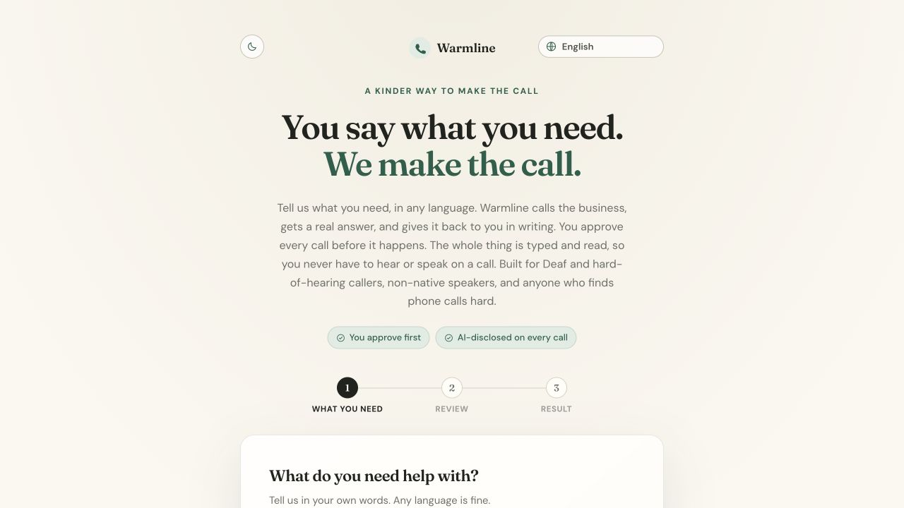

# Warmline

Type what you need, in whatever language you think in. Warmline places the phone
call and hands the answer back to you in writing, in your language. The whole
experience is typed and read, so you never have to hear or speak on a call.

Built for Deaf and hard-of-hearing callers, non-native speakers, and anyone who
finds phone calls hard. It works like a relay service, with an AI agent on the
phone instead of a human operator.

**[Try the live demo](https://warmline-production-a583.up.railway.app/)** with no
sign-up. It runs in mock mode, so the whole flow is safe to walk through.



React 19, TypeScript, and Fastify, calling through [CALL-E](https://call-e.devpost.com/).

## What it does

- Describes a task in any of 30+ languages, and translates the interface to match,
  either from the language picker or from what you typed.
- Sends the same task to up to five businesses at once and shows their answers
  side by side.
- Rates each result high, medium, or low confidence, and badges the best
  confident answer so you do not have to compare rows yourself.
- Returns typed fields (availability, price, hours, outcome) plus short evidence
  lines quoting what was said on the call, rather than a raw transcript.
- Renders results in your language and English together, with a one-tap toggle,
  so someone reading along in English can follow.
- Calls you back and reads the results aloud in your language, if you would
  rather listen than read.
- Dials nothing until you approve the plan. The agent discloses that it is an AI
  and never books, pays, or commits to anything.

## How it works


A calm three-screen flow: **describe → review → results.** Nothing calls anyone
until you say so.

## Four ways to ask, one flow

Warmline reads your free text and routes it to the mission template that fits,
each with its own intake and typed result schema:

| Mission | What it is for | Example |
|---------|----------------|---------|
| **Appointment scout** | Find the earliest opening without booking anything | "When is the earliest dentist appointment this week?" |
| **Lost & found** | Check whether a place has your lost item | "Did I leave a blue umbrella at the library yesterday?" |
| **Reachability check** | Confirm hours, whether they are open, or that a number reaches a human | "Is the pharmacy open right now and do they take walk-ins?" |
| **Generic errand** | Any other single question for a business | "Ask the bakery if they have gluten-free bread today." |

You do not pick the template. Warmline classifies your request (via an LLM, with
a keyword fallback when no key is set) and generates a concrete, do-no-harm call
goal like *"ask for the earliest appointment; do not book anything."*

## Language handling

- **Auto-detect from what you type.** Write your request in any language, and the
  button offers to flip the page into it by name: *"Show this page in Español."*
- **Or pick it directly.** Choosing from the language dropdown translates the
  whole interface instantly, even before you have typed anything, for someone who
  cannot read the English form at all.
- **30+ languages** in the picker, from Spanish, Chinese, and Vietnamese to
  Arabic, Hindi, Haitian Creole, Amharic, Somali, and Ukrainian. The UI is
  translated live by an LLM, so any language works, not only the listed ones.
- **An in-language "loading" moment** while the page switches.
- **Answers in two languages.** Results come back in the person's language *and*
  English, with a one-tap toggle, so an English-speaking friend or family member
  can read along.
- **Or hear it out loud.** When the task is done, Warmline can call the person
  back and read the results aloud in their language, on top of the written
  answer, for anyone who would rather listen than read.
- **The language switcher is always in the top-right.**
- **Right-to-left aware** for Arabic, Farsi, Urdu, Pashto, and Hebrew.

Two independent "language knobs" make this work:

| Knob | Controls | Powered by |
|------|----------|------------|
| `userLocale` | The interface and the written answer | LLM translation (Claude or OpenAI) |
| `callLocale` | The language the agent **speaks on the phone** | CALL-E's region + locale |

So the person can read the interface in Tagalog while the agent calls a clinic in
English, or the reverse. The two ends of the call are decoupled on purpose.

A live example of the interface translating itself:

| English | Español (detected live) |
|---------|-------------------------|
| Show this page in my language | Mostrar esta página en mi idioma |
| View in English | Ver en inglés |

## Built on CALL-E

Warmline places its real phone calls through [**CALL-E**](https://call-e.devpost.com/)
("Your Code Is Calling"), an agentic calling platform: you hand it a task and a
phone number, and its voice agent makes the call and hands back a structured
result. 
**How the integration works** (`server/index.ts`): for each approved target,
Warmline calls `CalleClient.calls.createAndWait(...)` from the `@call-e/calle`
SDK, passing:

- **`task`**: the per-mission call goal Warmline generated from the user's intent
  (e.g. "ask for the earliest appointment; do not book anything"), always prefixed
  with a spoken AI-disclosure line and a hard rule that the agent must not book,
  pay, or commit to anything.
- **`recipient`**: the business phone in E.164, plus a **`locale`** (the
  `callLocale`) and a **`region`** so the call can happen in a different language
  than the person's own interface. CALL-E ties the language its agent *speaks* to
  the recipient region (Spanish under `MX`, Hindi under `IN`, Arabic under `AE`,
  and so on), so Warmline maps the chosen `callLocale` to a region CALL-E supports
  that language in (`regionForCallLocale`), falling back to `CALLE_REGION`.
- **`resultSchema`**: the mission's structured-output schema, so CALL-E returns
  typed fields (availability, price, outcome, evidence) instead of a blob of text.
- **`metadata`** and an **`idempotencyKey`**, so every call is traceable and can
  never be accidentally placed twice.

Warmline uses CALL-E **twice** in the same flow: once to call the **business** and
get the answer, and again, optionally, to call the **user back** and read that
answer aloud in their language. The structured result CALL-E returns is what makes
the callback trustworthy, Warmline reads back typed fields, not an improvisation.

## Guardrails

Every CALL-E call is wrapped in:

- **Approval-first review.** You confirm the plan before anything dials.
- **Spoken AI disclosure.** The agent always says it is an AI.
- **Server-side allowlist** (`CALLE_ALLOWED_NUMBERS`) and E.164 validation.
- **Owner authorization.** Both real business calls and voice callbacks require
  a private `WARMLINE_OWNER_TOKEN` in the `Authorization: Bearer` header.
- **Bounded dispatch.** Each server process permits ten real call attempts in
  a rolling ten-minute window, shared by business calls and callbacks.
- **No booking, paying, or committing** on your behalf.
- **Idempotency keys** per call, and a maximum of 5 targets.
- **Off by default.** Without `ALLOW_REAL_CALLS=true` and `CALLE_API_KEY`,
  Warmline uses its mock engine. With real mode opted in, missing owner or
  recipient configuration blocks dispatch with HTTP 503. Missing or incorrect
  owner authorization returns 401, a disallowed number returns 403, and the
  call-attempt limit returns 429 with `Retry-After`.

## Under the hood

- **Intent interpretation** (`src/domain/interpret.ts`): real LLM classification
  and field extraction, with a keyword-classifier fallback if no key is set.
- **Four mission templates** (`src/domain/missions/`): lost & found, appointment
  scout, reachability check, and a generic catch-all, each with its own intake and
  result schema and its own confidence/evidence handling.
- **Translation boundaries** (`src/domain/translate.ts`): batched LLM translation
  at each language edge, a no-op when the two locales match, with results cached.
- **Provider-agnostic LLM layer** (`src/domain/llm.ts`): works with **either** an
  Anthropic key or an OpenAI key. If both are set, Anthropic is preferred. An
  OpenAI key pasted into `ANTHROPIC_API_KEY` by mistake still works, since
  Warmline only treats it as Anthropic if it starts with `sk-ant`.
- **Offline-safe**: with no keys set, everything falls back to keyword
  interpretation, marker-stub translation, offline locale detection, and mock
  calls, with no network requests. The live demo above walks the entire flow
  without dialing a real number.

## Quickstart

```bash
pnpm install
pnpm dev
```

Open `http://localhost:5173`. The Vite dev server proxies `/api` to
`http://localhost:8787`.

Production build:

```bash
pnpm build
pnpm start
```

Or skip setup entirely and try the hosted version:
**[warmline-production-a583.up.railway.app](https://warmline-production-a583.up.railway.app/)**

## Environment

Copy `.env.example` to `.env` and set what you need:

| What you set | What you get |
|--------------|--------------|
| Nothing | Keyword interpretation, stub translation, mock calls. Fully offline. |
| `ANTHROPIC_API_KEY` **or** `OPENAI_API_KEY` | Real LLM interpretation, translation, and UI localization. Calls still mocked. |
| `ALLOW_REAL_CALLS=true` **+** `CALLE_API_KEY` **+** `WARMLINE_OWNER_TOKEN` **+** `CALLE_ALLOWED_NUMBERS` | Owner-authorized real phone calls via CALL-E, restricted to the allowlisted numbers and call-attempt limit. |

For real calls, generate a random owner token of at least 32 characters and
store it as a private server environment variable. API clients must send it in
the bearer authorization header over HTTPS. The browser demo has no owner-token
entry screen. To use its interface with real calls, put it behind an
authenticated owner gateway that injects the bearer header for
`/api/missions/run` and `/api/missions/callback`, strips any client-supplied
authorization header, and prevents access to the backend around the gateway.
The mock interface works directly without this gateway.

The same allowlist covers business targets and the person receiving a voice
callback. A mission containing any disallowed target is refused before its
first call. Each accepted target reserves one attempt; a callback reserves one.
Failed provider calls also consume attempts. Limits are held in memory and
reset on process restart. Multiple server replicas need a shared limiter at the
gateway. Language-model interpretation and translation keep their existing
configuration and are separate from the phone-dispatch boundary.

Run the dispatch-boundary checks with Node.js 22.11 or newer:

```bash
pnpm test
```

These checks exercise mock access, owner authorization, recipient checks and
call limits without contacting a provider.

## Project structure

```text
src/
  App.tsx              Three-screen intent -> plan -> results UI
  i18n/strings.ts      English source strings (everything else is translated live)
  domain/
    base.ts            Shared target/mission schemas, safety preamble, guards
    template.ts        MissionTemplate<TInput, TData> contract
    missions/          lostAndFound, appointmentScout, reachability, generic
    registry.ts        kind -> template lookup
    interpret.ts       free-text -> plan (LLM, keyword fallback)
    translate.ts       locale-boundary translation (LLM, stub fallback)
    llm.ts             provider-agnostic LLM layer (Anthropic + OpenAI)
  styles.css
server/
  index.ts             Fastify API: intent, missions/run, localize, callback, health; CALL-E path
```

## License

MIT
